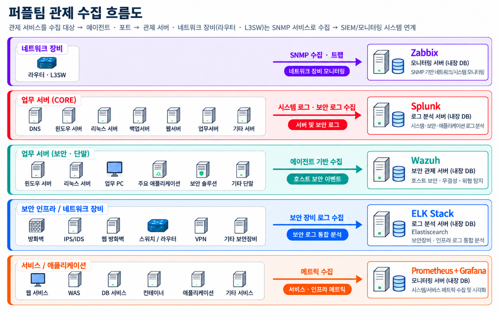
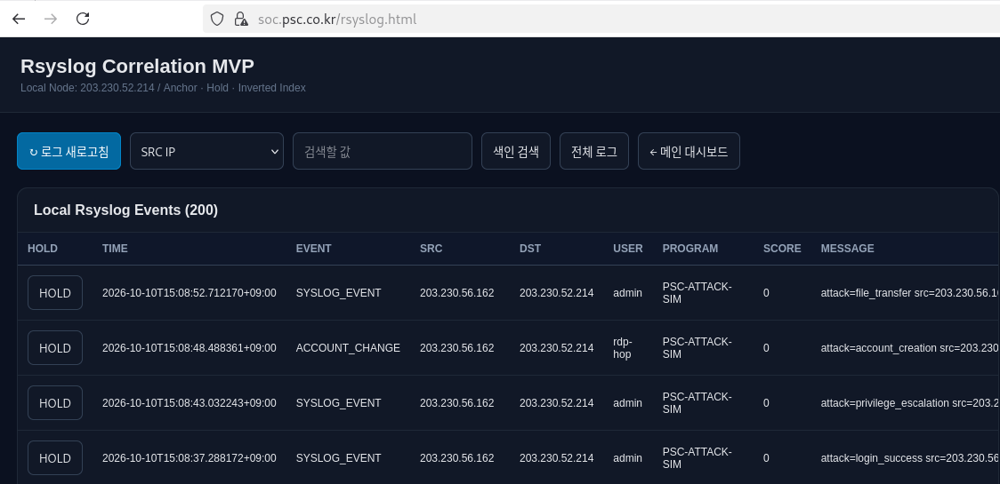
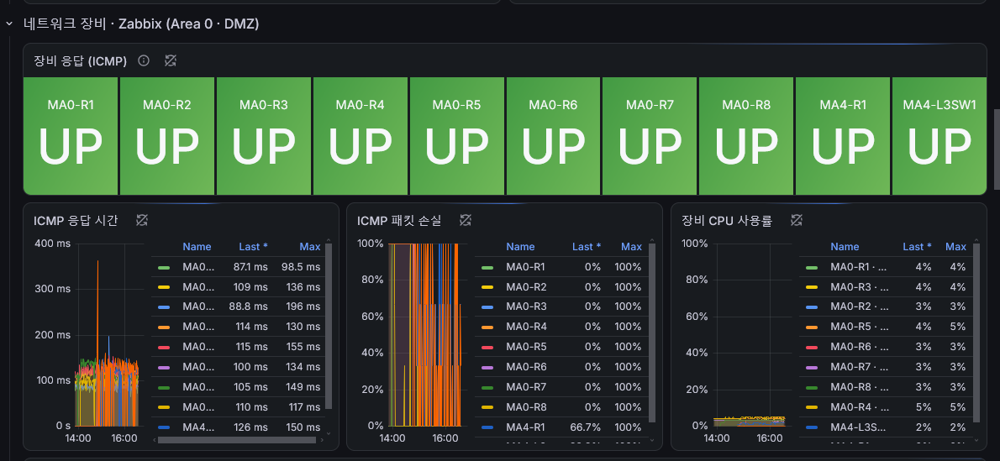

  

  # Campus Security Operations

  **대학 IT 인프라 구축 · 모의해킹 · 통합 보안관제**

  본교·분교 서비스를 직접 구성하고, 승인된 공격 시나리오를 실행해 인프라와 탐지 체계를 함께 검증한 팀 프로젝트입니다.

  
  
  

## 한눈에 보기

| 설계 | 구현 | 검증 | 관제 |
| :--- | :--- | :--- | :--- |
| 본교·분교·DMZ 분리 | 웹·메일·파일·DB 서비스 | 장애 전환과 접근 통제 | ELK·Splunk·Wazuh·Zabbix |
| 라우팅·VPN·ACL | 로드 밸런싱·백업·자동화 | 승인된 모의해킹 시나리오 | 로그와 운영 지표의 교차 분석 |

## 01 · 캠퍼스 네트워크를 설계하고 연결

본교의 학사·연구·관리 영역과 분교, DMZ를 분리해 필요한 통신만 허용했습니다. 캠퍼스 간 경로에는 라우팅과 VPN을 적용하고, 주요 링크와 장비의 장애 전환을 시험했습니다.

▲ 전체 논리 토폴로지 · 보고서 8쪽

구간별 구성과 라우팅 증적은 [네트워크 설계와 검증](docs/network-and-infrastructure.md)에서 볼 수 있습니다.

## 02 · 대학 서비스를 운영할 기반 구축

학사 웹, 메일, 연구자료 공유와 데이터베이스를 배치했습니다. HAProxy, 게이트웨이·방화벽 이중화, 백업, Ansible 자동화를 적용하고 장애 시 경로와 서비스 상태를 확인했습니다.

▲ 서버 물리 구성도 · 보고서 40쪽

▲ 방화벽 Active/Standby 장애 전환 증적 · 보고서 62쪽

서비스 흐름, 메일 검사, 접근 통제와 백업 증적은 [서비스 구축과 안정성](docs/services-and-resilience.md)에 정리했습니다.

## 03 · 공격 시나리오로 보안 통제 검증

승인된 범위에서 피싱·계정 악용·웹 취약점·네트워크 가용성 침해 시나리오를 재현했습니다. 단계별 공격 경로와 수집된 증적을 대조하고, 취약점 조치와 남은 한계를 기록했습니다.

▲ 모의해킹 공격 흐름 · 보고서 145쪽

시나리오와 결과는 [모의해킹과 조치](docs/security-validation.md)에서 확인할 수 있습니다. 이 자료는 승인된 실습 환경에서 수행한 검증 기록입니다.

## 04 · 여러 관제 신호를 함께 읽기

웹·메일·호스트·네트워크 로그를 중앙에서 수집하고 ELK, Splunk, Wazuh와 자체 관제 화면에서 확인했습니다. Zabbix·Prometheus의 상태 지표를 더해 공격 징후와 운영 장애를 구분했습니다.

▲ SIEM 로그 수집 흐름 · 보고서 206쪽

▲ 자체 관제 화면의 이벤트 목록 · 보고서 210쪽

▲ 인프라 상태 모니터링 · 보고서 233쪽

제품별 탐지 화면과 운영 지표는 [통합 관제와 탐지 증적](docs/security-operations.md)에 묶었습니다.

## 결과와 다음 과제

- 네트워크 연결, 장애 전환, 서비스 접근 통제, 메일 검사와 로그 수집을 단계별로 검증했습니다.
- 자체 관제 화면은 여러 도구의 정보를 조회할 수 있지만, 제품 간 탐지 결과를 **하나의 사건으로 자동 병합하는 기능**은 후속 과제입니다.
- 비표준 로그 파서, 호스트 간 공격 흐름 추적, 승인 기반 자동 대응과 복구 절차는 추가 검증이 필요합니다.

검증 범위와 한계는 [프로젝트 요약](docs/project-summary.md)과 [관제 검증 및 후속 과제](docs/detection-and-next-steps.md)에 구분해 적었습니다.

## 참여 범위

네트워크·서버 구축, 모의해킹 검증, 통합 관제와 결과 정리 등 **프로젝트 전 과정에 참여**했습니다. 팀 전체 결과와 개인이 직접 구현한 항목을 혼동하지 않도록, 구체적인 개인 담당 범위는 확인 가능한 작업 자료에 맞춰 별도로 기재할 수 있습니다.

## 사용 기술

`VLAN` `OSPF` `EIGRP` `IPsec VPN` `Cisco ASA` `ACL` `NAT` `Linux` `Windows Server` `HAProxy` `MariaDB` `Ansible` `ELK` `Splunk` `Wazuh` `Zabbix` `Prometheus`

## 보고서 원본 이미지

이 README와 네 분야의 상세 문서에는 제공된 248쪽 결과 보고서에서 추출한 **이미지 363개를 내용에 맞는 위치에 사용**했습니다. 원본 파일을 쪽수와 순서대로 보존한 [전체 자료 목록](report-gallery/README.md)도 제공하며, 이미지에는 실습망 주소·계정명·이메일 주소·공격 로그가 그대로 표시될 수 있습니다. 별도 설치 파일과 인증정보 파일은 포함하지 않았습니다.

메가스터디 AI 캠퍼스 정보보안 전문가 과정 · 2026년 9월–10월

