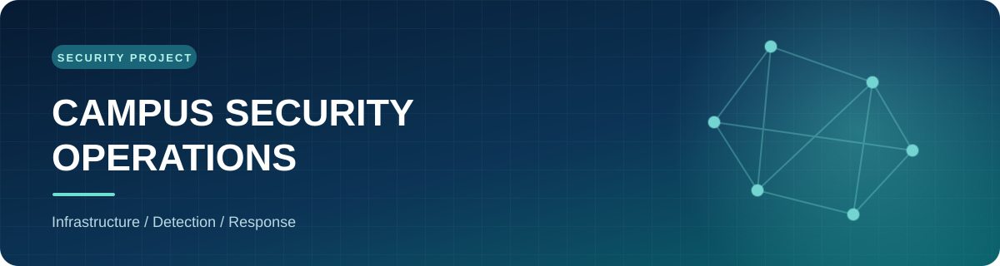
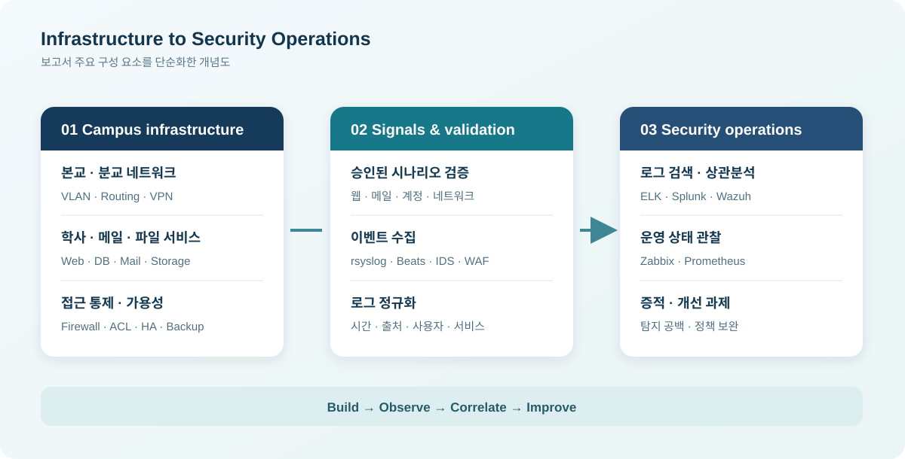

  

  # Campus Security Operations

  **대학 IT 인프라 구축과 모의해킹 기반 통합 보안관제**

  캠퍼스 네트워크와 주요 서비스를 설계·구축하고, 승인된 공격 시나리오의 흔적을 여러 관제 도구에서 추적한 팀 프로젝트입니다.

  
  
  

## 프로젝트 한눈에 보기

| 영역 | 구현·검증 내용 |
| :--- | :--- |
| **네트워크** | 본교·분교와 학사·연구·관리망을 분리하고 라우팅, VPN, ACL, NAT, 방화벽 및 이중화 구성 |
| **서버** | 웹·학사·메일·파일 공유 서비스, 로드 밸런싱, 백업 및 Ansible 기반 운영 자동화 |
| **보안 검증** | 승인된 범위에서 복합 공격 시나리오를 재현하고 취약점과 보안 통제의 동작을 점검 |
| **통합 관제** | 시스템·애플리케이션·보안 로그를 수집해 ELK, Splunk, Wazuh와 운영 모니터링 화면에서 분석 |

## 아키텍처

  

> 이 그림은 보고서의 주요 구성 요소를 단순화한 **개념도**입니다. 실제 주소, 장비 연결 및 접근 정책은 포함하지 않았습니다.

## 주요 흐름

1. **서비스 구성** — 본교·분교 네트워크와 DMZ에 학사 웹, 메일, 파일 공유 및 운영 서비스를 배치합니다.
2. **가용성 확보** — 게이트웨이·방화벽·링크·서버 계층에 이중화와 백업을 적용하고 장애 전환을 점검합니다.
3. **공격 재현** — 승인된 시나리오를 통해 웹, 메일, 계정, 파일 및 네트워크 경로의 보안 통제를 검증합니다.
4. **증적 분석** — 여러 출처의 로그와 지표를 시각·호스트·사용자 단위로 대조해 공격 흐름과 운영 장애를 구분합니다.
5. **개선안 도출** — 확인된 취약점과 탐지 공백을 정책 보완, 로그 정규화, 경보 조정 과제로 연결합니다.

## 사용 기술

| 분야 | 기술 |
| :--- | :--- |
| 네트워크·보안 | VLAN, OSPF, EIGRP, IPsec VPN, Cisco ASA, ACL, NAT, Snort |
| 서비스·운영 | Linux, Windows Server, Nginx, Apache, HAProxy, MariaDB, Postfix, Ansible |
| 관제·분석 | rsyslog, Beats, Logstash, Elasticsearch, Kibana, Splunk, Wazuh, Zabbix, Prometheus, Cuckoo |

## 검증 결과와 한계

- 이중화, 접근 통제, 메일 보안, 로그 수집 및 시나리오별 탐지 결과를 보고서에 기록했습니다.
- 여러 관제 화면을 한곳에서 접근할 수 있게 구성했지만, 제품 간 탐지 결과를 **하나의 사건으로 자동 병합하는 기능**은 후속 과제입니다.
- 로그의 공통 필드화와 유사 이벤트 연결을 구현했으나, 비표준 로그 파서 확대와 호스트 간 공격 흐름의 자동 추적은 추가 검증이 필요합니다.
- 대응 플레이북, 승인 후 차단·격리, 대응 이력 관리는 아직 구현되지 않았습니다. 이 저장소는 완성된 SOAR 또는 XDR 제품을 주장하지 않습니다.

## 자료

- [프로젝트 범위와 결과 요약](docs/project-summary.md)
- [관제 검증과 후속 과제](docs/detection-and-next-steps.md)

## 자료 공개 기준

이 저장소에는 프로젝트 개요와 단순화된 구조를 정리했습니다. 원본 보고서의 실제 주소, 계정, 인증정보, 상세 공격 절차 및 미검토 설치 파일은 포함하지 않았습니다. 팀 구성원의 개별 기여와 공개 가능한 원본 코드·시연 자료는 확인 후 추가할 예정입니다.

메가스터디 AI 캠퍼스 정보보안 전문가 과정 · 2026년 9월–10월

